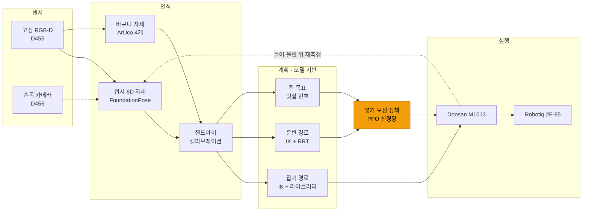

# 슬라이드 브리프: 접시 → 식기세척기 바구니 자동 거치 파이프라인 (2026-10-16)

디자이너·발표용 정리다. 슬라이드 2장: ① 실행 파이프라인(실기), ② 학습 루프(sim). 박스 문구는 그대로 써도 되도록 짧게 적었다.

---

## 슬라이드 1 — 실행 파이프라인 (실기)

**제목:** 카메라에서 거치까지: 인식 → 계획 → 학습 보정 → 실행
**한 줄 메시지:** 경로는 기하 계산으로 안전하게 만들고, 마지막 넣기만 학습 정책이 상황마다 보정한다.

### 배치 (왼쪽 → 오른쪽 5열, 화살표로 연결)

| 열 | 박스 (위 → 아래) | 색 |
|---|---|---|
| ① 센서 | **고정 RGB-D 카메라** (Intel D455) / **손목 카메라** (D455, 그리퍼 위) | 회색 |
| ② 인식 | **접시 6D 자세** — FoundationPose (사전학습 신경망) / **바구니 자세** — ArUco 마커 4개 / **좌표 변환** — 핸드아이 캘리브레이션 (카메라 → 로봇) | 파랑 (인식) |
| ③ 계획 | **잡기 경로** — 수치 IK + 경로 라이브러리 / **운반 경로** — IK + RRT, 충돌 검사 / **분면·칸 목표** — 빗살 번호 → 목표 위치 | 초록 (모델 기반) |
| ④ 학습 보정 | **넣기 보정 정책 (PPO 신경망)** — 입력: 칸·바구니 자세·손 안 접시 자세 → 출력: 겨냥 x·y, 기울임, 깊이, yaw | **주황 (학습)** — 가장 눈에 띄게 |
| ⑤ 실행 | **로봇 팔** Doosan M1013 (관절 경로, 저속) / **그리퍼** Robotiq 2F-85 (잡기·놓기) | 진회색 |

### 화살표 문구
- ① → ② : "RGB-D 영상"
- ② → ③ : "접시·바구니 위치 (로봇 좌표)"
- ③ → ⑤ : "잡기·운반 경로"
- ③ → ④ : "바구니 위 정지 상태"
- ④ → ⑤ : "보정된 넣기 경로"
- ⑤ → ② (점선, 되돌아오는 화살표): "들어 올린 뒤 손 안 접시 다시 측정"

### 아래 띠 (작은 글씨, 안전 장치)
최저 속도 운반 · 관절 한계(컨트롤러 기준) · 충돌 여유 검사 · 넣기 힘 감시(옵션) · 사람 감독 하 실행

### 오른쪽 위 숫자 상자 (선택)
- 넣기 성공률 (시뮬레이션, 처음 보는 배치 415회, 실제와 같은 오차 조건)
  - 기존 튜닝 방식 **54.5%** → 학습 보정 **67.7%**
  - 틈 위치를 손목 카메라로 볼 경우 **84.1%** (개발 중)

---

## 슬라이드 2 — 학습 루프 (시뮬레이션)

**제목:** 시뮬레이션에서 오차를 일부러 섞어 학습한다
**한 줄 메시지:** 모델이 실물과 조금씩 달라도 정책이 스스로 보정하도록 PPO로 학습.

### 원형 루프 (시계 방향 4칸) + 가운데 신경망

1. **Isaac Lab 디지털 트윈** — 로봇·바구니·빗살·접시 물리
2. **오차 랜덤화** — 빗살 위치, 바구니 각도, 손 안 접시, 카메라 잡음
3. **넣기 시도** — 계획기 경로 + 정책 보정 (한 번에 96~192개 병렬)
4. **보상** — 목표 칸에 앉음 +1 / 다른 칸·걸림·넘어짐 감점
- 가운데: **PPO 신경망 (128-128)** — 보상으로 가중치 업데이트 → 다음 시도에 반영

### 오른쪽 작은 그래프 (선택)
- x: 학습 회차, y: 처음 보는 배치 성공률. 자료: `rl/logs/basket/insert_rl_20261016_noseen_drfull_canon*/history.json`
- 그림 규칙: 격자 없음, 위·오른쪽 테두리 없음, 그래프 안 제목 없음.

### 아래 띠
학습 결과(정책 파일)를 그대로 실기 파이프라인 ④에 연결

---

## 디자인 메모
- 색은 4종류만 써서 **"학습한 부분"(주황)**이 한눈에 보이게 한다. 나머지(인식 파랑, 모델 기반 초록, 하드웨어 회색)는 톤을 낮춘다.
- 사진 자리: ① 열에 고정 카메라 화면(빨간 접시 + 바구니 마커), ⑤ 열에 로봇이 바구니에 넣는 사진.
  - 원본: `calibration/data/real_pipeline/20261015_*/wrist_above.png`, 고정 카메라 캡처
- 용어: "강화학습(PPO)", "디지털 트윈(Isaac Lab)", "6D 자세 추정(FoundationPose)". 회사·제품 로고는 넣지 않는다.

## 참고: 빠른 초안용 Mermaid (슬라이드 1)

